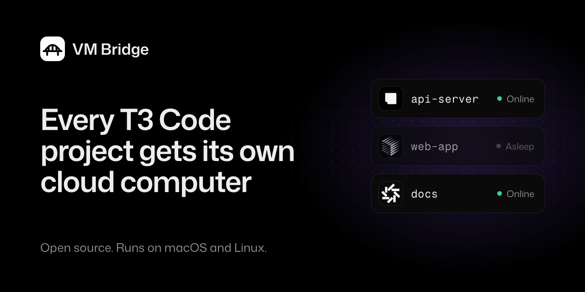

# VM Bridge



VM Bridge is a free, open source server that runs [T3 Code](https://github.com/pingdotgg/t3code)
agents on cloud VMs. Pair T3 Code with it once, and it gives each project its own VM, puts idle VMs
to sleep and wakes them when you send a message. It runs on macOS and Linux, and you pay only your
cloud provider for the VMs.

Website and docs: [vmbridge.ordinity.com](https://vmbridge.ordinity.com)

- Use several providers at once: boxd, Instabox, Daytona, Boat, Railway, E2B, Freestyle and
  Superserve. New VMs go to your default provider, or to the one you pick for a repository.
- A VM sleeps when it sits idle and wakes when you send a message.
- One dashboard, behind a password, for providers, GitHub, agent sign-ins, pairing devices and a
  live view of your VMs.
- Agent skills from [skills.sh](https://skills.sh) or from this machine reach every VM, for Claude
  Code and Codex.
- Your global `AGENTS.md` (and Claude Code's `CLAUDE.md`) on this machine can follow you to every VM.
- Works over your local network and Tailscale.

## Install

macOS and Linux:

```sh
curl -fsSL https://raw.githubusercontent.com/vkpdeveloper/vmbridge/main/install.sh | sh
```

This installs one `vmbridge` file in `~/.local/bin` (set `VMBRIDGE_INSTALL_DIR` to change it).
Run the same command again to update.

## Get started

1. Run `vmbridge` and choose a dashboard password.
2. Open `/dashboard` on one of the addresses it prints, and log in.
3. Under **Setup**, add a provider, connect GitHub and sign in your agents.
4. Under **Devices**, create a pairing link and paste it into T3 Code as a remote environment.

Start a thread in T3 Code and VM Bridge brings up a VM for it.

## Skills

Under **Skills**, install agent skills from skills.sh, or pick ones found in `~/.claude/skills`,
`~/.agents/skills` or `~/.codex/skills` on this machine. Every VM gets them for Claude Code and
Codex: awake VMs right away, without restarting anything, and sleeping VMs before they serve
anything when they wake. Edits to a local skill reach the VMs within a few seconds. Removing a
skill takes it off every VM, and skills put on a VM some other way are left alone.

Switch on **Sync all** to install every skill on this machine without picking them one by one. New
skills in those folders follow within a few seconds, and a skill deleted here comes off the VMs. When
two folders hold a skill with the same name, the first in the order above wins. Skills over 5 MB are
skipped. Turning it off keeps what it installed until you remove it.

The AGENTS.md section on the same page lists each agent's global file found on this machine,
`~/.claude/CLAUDE.md` for Claude Code, `~/.codex/AGENTS.md` for Codex and
`~/.config/opencode/AGENTS.md` for OpenCode (`$CLAUDE_CONFIG_DIR`, `$CODEX_HOME` and
`$XDG_CONFIG_HOME` move them). Switch one on and every VM gets it where that agent reads it, the
same way as skills, and edits follow within a few seconds.
Switching it off, or deleting it here, takes it off the VMs. VM Bridge only replaces or removes a
file it wrote: if a VM already has its own, or the file was edited on the VM, it is left alone.

## Commands

```
vmbridge [run] [--host 0.0.0.0] [--port 3774]   Start in this terminal
vmbridge stop                                   Stop, including the background service
vmbridge service install [--host] [--port]      Run in the background at login
vmbridge service uninstall                      Remove the background service
vmbridge password                               Set a new dashboard password
```

Your data lives in `~/.vmbridge`. Set `VMBRIDGE_HOME` to keep it somewhere else. On a machine with
no terminal, set `VMBRIDGE_PASSWORD` for the first start.

Sizes, sleep behaviour and notes for each provider: [docs/PROVIDERS.md](docs/PROVIDERS.md).

## License

[MIT](LICENSE)
